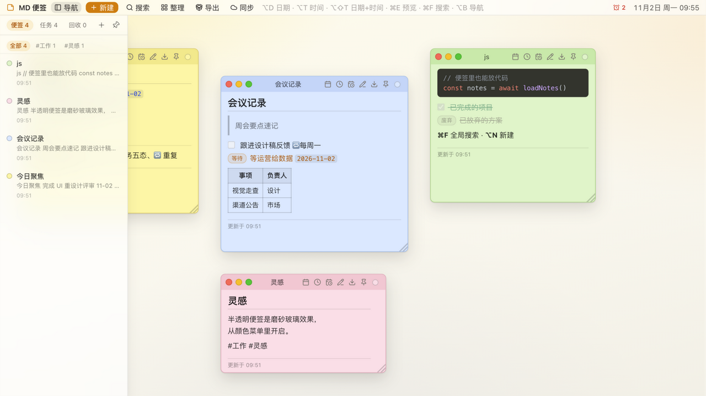

# MD 便签 (MD Sticky Notes)

**每张便签，就是你网盘里的一个 `.md` 文件。**

macOS / Windows 桌面便签：一张张可拖拽的 Markdown 小窗口，内容以纯 `.md` 文件存放在
你自己的云盘同步文件夹（坚果云 / iCloud Drive / Dropbox）——
**没有账号、没有自有云、没有锁定**，任何编辑器都能打开你的数据，换工具随时带走。

> English: Markdown-powered desktop sticky notes for macOS & Windows. Every note is a plain
> `.md` file (YAML frontmatter + Markdown body) living in *your* cloud-synced folder —
> no account, no vendor cloud, no lock-in. Free & open source (MIT).




## 为什么做这个

- Simplenote 已宣布停止积极开发——把数据放在别人的在线服务里，服务停了你就被动了；
- 微软正把 Windows 便签重建进 OneNote、绑定微软账号云——便签不该被迫登陆任何账号；
- 你想要便签的「轻」和「随手」，又想要 Markdown 的表达力，还想让数据真正属于自己。

这个应用就是这三个诉求的交集：**便签形态 + Markdown 原生 + 数据存你自己的网盘**。

## 功能亮点

- **五态任务**：待办 → 进行中 → 等待 → 完成 → 废弃，预览里点击循环切换、右键精确设置；
  文本里写日期自动排序、临期/逾期标红；`🔁每天 / 🔁每3天 / 🔁每周五 / 🔁每月1号` 重复任务完成自动滚到下一周期
- **提醒**：任务里写时间（`15:30` / `2026-10-25` / `2026-10-25 09:30`）到点弹系统通知
- **Markdown 编辑 / 预览**：代码高亮、表格、任务列表、图片；粘贴截图自动保存、Excel/网页表格粘贴自动转 Markdown 表格
- **桌面化交互**：拖动（边缘吸附对齐）、缩放、折叠、置顶、半透明磨砂、一键整理、⌘F 全局搜索
- **多机同步**：数据在你已有的云盘里，另一台机器装上应用指向同一文件夹即可，文件改动实时互现
- 侧栏汇总、#标签筛选、回收站（30 天可恢复）

## 下载 (Download)

| 平台 | 文件 | 说明 |
| --- | --- | --- |
| macOS Apple Silicon | `MD-Sticky-Notes_0.1.0_aarch64.dmg` | M1 及之后 |
| macOS Intel | `MD-Sticky-Notes_0.1.0_x64.dmg` | Intel 芯片 |
| Windows 10 / 11 | 开发中（点 ★ / Watch 等发布） | NSIS 安装包，免管理员 |

**macOS 首次打开**（当前版本为 ad-hoc 签名，打开时会提示无法验证开发者，属正常现象）：
方法一：在 Finder 里**右键点应用 → 打开 → 打开**；方法二：双击后到
**系统设置 → 隐私与安全性**，点「仍要打开」。只需一次，之后正常启动。

**Windows 首次运行**（未签名，SmartScreen 会提示）：点「更多信息」→「仍要运行」。只需一次。

下载入口：[GitHub Releases](https://github.com/glfruit/md-sticky-notes/releases/latest)

## 反馈

- 报 bug → [Issues](https://github.com/glfruit/md-sticky-notes/issues)
- 提建议 / 交流用法 → [Discussions](https://github.com/glfruit/md-sticky-notes/discussions)

## 快捷键

| 快捷键 | 功能 | | 快捷键 | 功能 |
| --- | --- | --- | --- | --- |
| ⌥N | 新建便签 | | ⌘E | 编辑 / 预览切换 |
| ⌃⌥N | 全局新建（任意应用内，可预填剪贴板） | | ⌘F | 搜索 |
| ⌥D / ⌥T / ⌥⇧T | 插入日期 / 时间 / 日期+时间 | | ⌥B | 固定 / 隐藏侧栏 |

## 存储格式

桌面版每张便签一个 `<id>.md` 文件，元数据存放在 YAML frontmatter：

```markdown
---
color: yellow        # yellow | blue | green | pink | purple | gray
x: 60                # 画布内坐标（像素）
y: 42
width: 360
height: 460
collapsed: false     # 是否折叠为标题栏
preview: true        # true = Markdown 预览，false = 源码编辑
pinned: false        # 置顶显示
translucent: false   # 半透明磨砂
z: 1                 # 层级
updatedAt: 1760000000000
---

（Markdown 正文）
```

- 没有 frontmatter 的 `.md` 文件放进文件夹会被当作新便签导入（默认黄色、预览模式）
- 图片附件存放在 `attachments/` 子目录，正文用 `` 引用
- 回收站是 `.trash/` 子目录，条目保留 30 天
- 文件写入为原子写（临时文件 + rename），崩溃不会产生半份文件

## 开发

```bash
npm install                    # 安装前端依赖
npm run tauri dev              # 桌面版开发（自动起 vite + cargo）
npm run dev                    # 仅网页版（localStorage / IndexedDB 存储）
npm test                       # 单元测试（vitest）
npm run lint                   # ESLint
bash scripts/build-desktop.sh  # 打包（自动注入 .env 的 updater 签名密钥）
```

> 桌面构建需要 `TAURI_SIGNING_PRIVATE_KEY` 环境变量（updater 签名用，Tauri 不读 .env），
> 所以打包走 `scripts/build-desktop.sh`；密钥的生成与配置见[发布 runbook](docs/release-runbook.md)。

Rust 侧代码在 `src-tauri/`，主要负责文件 IO（便签读写、附件、原子写）、文件夹监听（notify）、
全局热键、系统托盘与剪贴板。

## 目录结构

```
src/
  App.tsx              # 桌面布局：菜单栏 / 侧栏 / 滚动画布 / 弹层
  components/          # StickyNote、Sidebar、SearchPanel、Markdown 等
  hooks/
    useNotes.ts        # 便签状态机：增删改、防抖落盘、z 层级、同步重载
    useReminders.ts    # 任务到点系统通知
  lib/
    editor.ts          # 纯函数：列表续接、任务状态机、重复任务、Markdown 清理
    note.ts            # deriveTitle 等内容派生
    storage/           # 存储适配器（localStorage / 同步文件夹）
    updater.ts         # 自动更新状态机
    attachments.ts     # 附件保存、URL 缓存、孤儿清理
```

## License

[MIT](./LICENSE)
